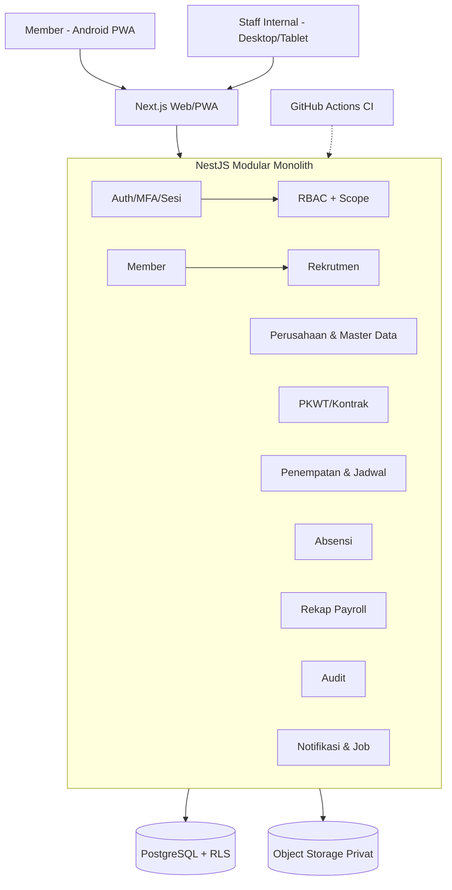

# Arsitektur Sistem

Rujukan keputusan: `architecture/0001-stack.md` (disetujui), `architecture/0002-usulan-teknis.md` (diusulkan).

## Gaya
Modular monolith, satu deployable, modul berbatas jelas. Bukan microservices.

## Hubungan modul
Auth → RBAC/Scope → Master Data → Penempatan → Absensi → Rekap Payroll → Laporan. Member → Rekrutmen → PKWT → Penempatan. Semua modul menulis ke Audit.

## Dua realm autentikasi
- Member: Google OIDC (`openid-client`), tanpa password lokal.
- Staff: password khusus HRIS (argon2id) + TOTP wajib.
Sesi server-side dengan cookie `HttpOnly`, `Secure`, `SameSite`; guard dan sesi terpisah per realm.

## Isolasi perusahaan (berlapis)
1. `company_id` NOT NULL pada tabel tenant.
2. Scope (perusahaan + lokasi) diturunkan dari sesi di server.
3. Lapisan repositori memaksa filter scope.
4. PostgreSQL Row-Level Security sebagai pertahanan terakhir.
5. Tes otomatis kebocoran lintas perusahaan (harus gagal bila RLS dimatikan).

## Penyimpanan file
Object storage privat S3-kompatibel; akses lewat URL bertanda tangan berumur pendek setelah cek hak akses; enkripsi saat disimpan. Selfie berkunci objek + `purge_after`.

## Pekerjaan latar
Antrean (usulan: pg-boss di PostgreSQL) untuk ekspor, PDF, notifikasi (outbox), purge retensi, pengingat kontrak.

## Notifikasi
Antarmuka `NotificationChannel`; email aktif; WhatsApp Business API dan push hanya stub nonaktif. Tidak ada layanan berbayar tanpa persetujuan.

## Lingkungan, operasi, DR
- Staging dan production terpisah total. Hosting: cloud/VPS region Indonesia (penyedia menyusul).
- HTTPS, firewall, backup otomatis terenkripsi (database + bucket), monitoring, log terstruktur, rencana DR.
- Target awal RPO 24 jam dan RTO 8 jam (asumsi, divalidasi lewat uji restore).

## Kapasitas (asumsi A-01)
Awal 1.000 pekerja/50 rekanan/100 lokasi; target 10.000/300/500. `attendance_records` dipartisi per bulan (±7,3 juta baris/tahun); keyset pagination; uji beban k6 pada Fase 7 dan 10.

## Kualitas
Migrasi versi, OpenAPI sebagai kontrak, tes otomatis (unit, integrasi PostgreSQL asli, isolasi, RBAC, E2E), CI GitHub Actions.
