# Rancangan Database

PostgreSQL. Prinsip: pisahkan **person**, **akun login**, **kontrak**, **penempatan**; riwayat tidak pernah ditimpa; uang `NUMERIC(18,2)`; tabel tenant ber-`company_id` + RLS; `audit_logs` hanya-tambah.

```mermaid
erDiagram
  companies ||--o{ user_company_scopes : ""
  users ||--o{ user_company_scopes : ""
  users ||--o{ user_roles : ""
  roles ||--o{ role_permissions : ""
  permissions ||--o{ role_permissions : ""
  users ||--o| google_identities : "member"
  users ||--o{ staff_mfa_factors : "staff"
  persons ||--o| users : ""
  persons ||--|| member_profiles : ""
  member_profiles ||--o{ member_documents : ""
  persons ||--o{ employees : "riwayat kerja"
  companies ||--o{ employees : "pengelola"
  companies ||--o{ job_vacancies : "pengelola"
  job_vacancies ||--o{ job_applications : ""
  persons ||--o{ job_applications : ""
  job_applications ||--o{ recruitment_stages : ""
  partners ||--o{ partner_contracts : ""
  companies ||--o{ partner_contracts : "pengelola"
  partners ||--o{ partner_locations : ""
  contract_templates ||--o{ employment_contracts : ""
  employees ||--o{ employment_contracts : ""
  employment_contracts ||--o{ contract_versions : ""
  employment_contracts ||--o{ contract_documents : ""
  employees ||--o{ work_assignments : ""
  partner_locations ||--o{ work_assignments : ""
  work_assignments ||--o{ work_schedules : ""
  shift_patterns ||--o{ work_schedules : ""
  partner_locations ||--o{ attendance_points : ""
  attendance_points ||--o{ attendance_records : ""
  employees ||--o{ attendance_records : ""
  attendance_records ||--|| attendance_selfies : ""
  attendance_records ||--o{ attendance_flags : ""
  attendance_records ||--o{ attendance_adjustments : ""
  employees ||--o{ device_registrations : ""
  payroll_periods ||--o{ payroll_recaps : ""
  payroll_recaps ||--o{ payroll_recap_items : ""
  employees ||--o{ payroll_recap_items : ""
  payroll_components ||--o{ payroll_recap_items : ""
  payroll_recaps ||--o{ payroll_recap_approvals : ""
  payroll_recaps ||--o{ export_jobs : ""
  users ||--o{ audit_logs : ""
```

## Tabel tambahan dari rancangan awal
`persons`, `google_identities`, `staff_mfa_factors`, `member_documents`, `status_histories`, `partner_contracts`, `shift_patterns`, `holidays`, `device_registrations`, `attendance_selfies`, `attendance_flags`, `contract_templates`, `contract_documents`, `payroll_recaps`/`payroll_recap_items`/`payroll_recap_approvals`, `export_jobs`, `retention_policies`/`system_settings`, `legal_holds`, `notification_outbox`, `notification_templates`, `user_company_scopes`, `role_assignment_approvals`, `bootstrap_tokens`.

## Perubahan penting
- `shift_patterns`: `crosses_midnight`, `tolerance_late_min`, `tolerance_early_min`, `schedule_type` (FIXED/FLEXIBLE); override toleransi di `partner_locations`.
- `holidays`: cakupan nasional, perusahaan, atau lokasi.
- `contract_templates`: versi dan status verifikasi (`BELUM_DIVERIFIKASI`/`TERVERIFIKASI`).
- `contract_documents`: jenis `GENERATED`/`SIGNED_SCAN`, versi, checksum SHA-256, pengunggah, waktu, status verifikasi HRD.
- `job_vacancies.managing_company_id` NOT NULL.
- `attendance_selfies`: kunci objek dan `purge_after` (dari kebijakan retensi).

## Dirancang tapi belum dibuat (menunggu fase payroll)
`payroll_runs`, `payroll_items`, `payment_records`, `payroll_rule_versions`.

## Constraint kunci
- Satu penempatan aktif per karyawan per rentang tanggal (exclusion constraint).
- Kontrak aktif tidak tumpang tindih.
- `attendance_records` unik per (karyawan, titik, jenis, tanggal-shift).
- Rekap payroll berstatus disetujui bersifat immutable; perubahan lewat koreksi bernomor versi.
- `audit_logs` hanya menerima INSERT.
- Satu `google_sub` terhubung ke satu pengguna.

## Kapasitas dan indeks
- `attendance_records` dipartisi per bulan; ±7,3 juta baris/tahun pada 10.000 pekerja dan 2 kejadian/hari.
- Indeks: `(employee_id, shift_date)`, `(attendance_point_id, occurred_at)`, `(company_id, shift_date)`.
- Keyset pagination untuk daftar besar; pekerjaan latar untuk ekspor.
- Selfie ≈4 GB/hari pada 10.000 pekerja (asumsi A-08).
