# Rancangan Database

PostgreSQL. Prinsip: pisahkan **person**, **akun login**, **kontrak**, **penempatan**; riwayat tidak pernah ditimpa; uang `NUMERIC(18,2)`; tabel tenant ber-`company_id` + RLS; `audit_logs` hanya-tambah.

```mermaid
erDiagram
  companies ||--o{ user_company_scopes : ""
  users ||--o{ user_company_scopes : ""
  users ||--o{ user_roles : ""
  roles ||--o{ role_permissions : ""
  permissions ||--o{ role_permissions : ""
  users ||--o| google_identities : "member"
  users ||--o{ staff_mfa_factors : "staff"
  persons ||--o| users : ""
  persons ||--|| member_profiles : ""
  member_profiles ||--o{ member_documents : ""
  persons ||--o{ employees : "riwayat kerja"
  companies ||--o{ employees : "pengelola"
  companies ||--o{ job_vacancies : "pengelola"
  job_vacancies ||--o{ job_applications : ""
  persons ||--o{ job_applications : ""
  job_applications ||--o{ recruitment_stages : ""
  partners ||--o{ partner_contracts : ""
  companies ||--o{ partner_contracts : "pengelola"
  partners ||--o{ partner_locations : ""
  contract_templates ||--o{ employment_contracts : ""
  employees ||--o{ employment_contracts : ""
  employment_contracts ||--o{ contract_versions : ""
  employment_contracts ||--o{ contract_documents : ""
  employees ||--o{ work_assignments : ""
  partner_locations ||--o{ work_assignments : ""
  work_assignments ||--o{ work_schedules : ""
  shift_patterns ||--o{ work_schedules : ""
  partner_locations ||--o{ attendance_points : ""
  attendance_points ||--o{ attendance_records : ""
  employees ||--o{ attendance_records : ""
  attendance_records ||--|| attendance_selfies : ""
  attendance_records ||--o{ attendance_flags : ""
  attendance_records ||--o{ attendance_adjustments : ""
  employees ||--o{ device_registrations : ""
  payroll_periods ||--o{ payroll_recaps : ""
  payroll_recaps ||--o{ payroll_recap_items : ""
  employees ||--o{ payroll_recap_items : ""
  payroll_components ||--o{ payroll_recap_items : ""
  payroll_recaps ||--o{ payroll_recap_approvals : ""
  payroll_recaps ||--o{ export_jobs : ""
  users ||--o{ audit_logs : ""
```



## Tabel tambahan dari rancangan awal
`persons`, `google_identities`, `staff_mfa_factors`, `member_documents`, `status_histories`, `partner_contracts`, `shift_patterns`, `holidays`, `device_registrations`, `attendance_selfies`, `attendance_flags`, `contract_templates`, `contract_documents`, `payroll_recaps`/`payroll_recap_items`/`payroll_recap_approvals`, `export_jobs`, `retention_policies`/`system_settings`, `legal_holds`, `notification_outbox`, `notification_templates`, `user_company_scopes`, `role_assignment_approvals`, `bootstrap_tokens`.

## Perubahan penting
- `shift_patterns`: `crosses_midnight`, `tolerance_late_min`, `tolerance_early_min`, `schedule_type` (FIXED/FLEXIBLE); override toleransi di `partner_locations`.
- `holidays`: cakupan nasional, perusahaan, atau lokasi.
- `contract_templates`: versi dan status verifikasi (`BELUM_DIVERIFIKASI`/`TERVERIFIKASI`).
- `contract_documents`: jenis `GENERATED`/`SIGNED_SCAN`, versi, checksum SHA-256, pengunggah, waktu, status verifikasi HRD.
- `job_vacancies.managing_company_id` NOT NULL.
- `attendance_selfies`: kunci objek dan `purge_after` (dari kebijakan retensi).

## Sudah dibuat (Fase 3A)
`companies` (minimal), `persons` (minimal), `users`, `google_identities`, `staff_credentials`, `staff_mfa_factors`, `mfa_recovery_codes`, `sessions`, `login_attempts`, `staff_invitations`, `password_reset_tokens`, `system_state`, `bootstrap_tokens`, `notification_outbox`, `roles`, `permissions`, `role_permissions`, `user_roles`, `user_company_scopes`, `approval_requests`. Identitas dan kredensial dibatasi per realm lewat FK komposit `(user_id, realm)`; email disimpan huruf kecil; token hanya disimpan sebagai hash. Tabel otorisasi memakai nama kolom `scope_company_id` (bukan `company_id`) karena bukan data tenant. Seed peran/permission dibangkitkan dari `docs/rbac.md` (`scripts/gen-rbac-seed.mjs`).

## Sudah dibuat (Fase 4A)
`companies` diperluas (kode singkat unik, data hukum, pengaturan jsonb), `company_documents`, `partners`, `partner_contacts`, `partner_locations`, `partner_contracts`, `partner_contract_documents`, `manpower_requirements`; `approval_requests` mendukung subjek perusahaan. Semua tabel anak ber-`company_id NOT NULL` + RLS; FK komposit `(partner_id, company_id)` mencegah rujukan lintas perusahaan.
```
companies 1─* partners 1─* partner_locations 1─* manpower_requirements
              │   └─* partner_contacts
              └─* partner_contracts 1─* partner_contract_documents
companies 1─* company_documents
```
Constraint: nama rekanan/lokasi aktif unik; `(company_id, contract_number)` unik; periode kontrak valid; koordinat lengkap-atau-kosong; radius 20–1000; penyetuju kontrak ≠ pembuat; kontrak AKTIF wajib punya penyetuju.

## Sudah dibuat (Fase 5)
`member_profiles` (status member, NIK `nik_enc` + `nik_hmac` unik, biodata, `review_note`), `member_documents`, `member_status_histories`, `job_vacancies` (`company_id`), `job_applications`, `application_status_histories`. Tabel member **tanpa `company_id`** (lintas perusahaan); tiga tabel lowongan/lamaran ber-RLS tenant ditambah kebijakan member (`lowongan_baca_member`, `lowongan_baca_pelamar`, `lamaran_baca_milik`, `lamaran_buat_milik`, `lamaran_tarik_milik`). Riwayat bersifat hanya-tambah (trigger).
```
persons 1─1 member_profiles ─┬─* member_documents
                             └─* member_status_histories
companies 1─* job_vacancies 1─* job_applications *─1 persons ; job_applications 1─* application_status_histories
```
Constraint: biodata wajib lengkap saat status ≥ MENUNGGU_VERIFIKASI; status terverifikasi wajib punya pemeriksa; satu KTP/foto diri aktif; satu lamaran aktif per (lowongan, orang).

## Sudah dibuat (Fase 6)
`contract_templates`, `employment_contracts`, `contract_versions` (hanya-tambah), `contract_documents` (scan), `contract_number_counters`, `contract_status_histories`, `placements` (+ `placement_status_histories`). Semua ber-`company_id` + RLS; FK komposit mencegah rujukan lintas perusahaan; kebijakan RLS membaca-milik untuk member (kontrak, penempatan, lokasi penempatannya). Ekstensi `btree_gist` untuk exclusion constraint penempatan.
```
job_applications 1─* employment_contracts *─1 contract_templates
employment_contracts 1─* contract_versions / contract_documents / contract_status_histories
employment_contracts 1─* placements *─1 partner_locations ; employment_contracts ─ extends ─ employment_contracts
```
Pelindung database: pembuat/pemeriksa/penyetuju berbeda; template terverifikasi sebelum PERSETUJUAN; scan terverifikasi sebelum DITANDATANGANI; template terverifikasi terkunci; penempatan AKTIF hanya bila kontrak AKTIF; penempatan non-final tidak tumpang tindih; riwayat hanya-tambah (aktor kosong hanya untuk "Otomatis: ...").

## Sudah dibuat (Fase 7)
`attendance_points`, `shift_patterns`, `work_schedules`, `holidays`, `device_registrations`, `attendance_records`, `attendance_selfies`, `attendance_flags`, `attendance_reviews` (hanya-tambah), `attendance_adjustments`, view `attendance_effective` (`security_invoker`), kolom toleransi di `partner_locations`, fungsi `retensi_selfie_hari`. Semua ber-`company_id` + RLS (migrasi 017–019).
```
partner_locations 1─* attendance_points ; placements 1─* work_schedules *─1 shift_patterns
persons 1─* device_registrations ; attendance_records *─1 {placement, point, location, shift, device}
attendance_records 1─1 attendance_selfies ; 1─* attendance_flags ; 1─* attendance_reviews (PERIKSA, PUTUSAN)
persons 1─* attendance_adjustments
```
Pelindung database: satu titik aktif per lokasi; kode QR unik; `crosses_midnight` konsisten dengan jam; unik (orang, titik, jenis, tanggal-shift) non-DITOLAK; kunci idempotensi unik per orang; alasan tolak sesuai status; putusan tinjauan wajib didahului pemeriksaan oleh orang berbeda (trigger); penyetuju koreksi ≠ pembuat (CHECK); selfie ≤ 300 KB, satu per rekaman; tinjauan hanya-tambah. Kebijakan baca-milik member dan dua kebijakan SELECT sempit (`titik_baca_kode`, `perangkat_baca_hash`) bergantung variabel transaksi yang hanya disetel kode server.

## Dirancang tapi belum dibuat (menunggu fase payroll)
`payroll_runs`, `payroll_items`, `payment_records`, `payroll_rule_versions`.

## Constraint kunci
- Satu penempatan aktif per karyawan per rentang tanggal (exclusion constraint).
- Kontrak aktif tidak tumpang tindih.
- `attendance_records` unik per (karyawan, titik, jenis, tanggal-shift).
- Rekap payroll berstatus disetujui bersifat immutable; perubahan lewat koreksi bernomor versi.
- `audit_logs` hanya menerima INSERT.
- Satu `google_sub` terhubung ke satu pengguna.

## Kapasitas dan indeks
- `attendance_records`: ±7,3 juta baris/tahun pada 10.000 pekerja dan 2 kejadian/hari. **Partisi bulanan ditunda ke Fase 10** (uji beban); saat ini tabel biasa dengan indeks yang disiapkan.
- Indeks: `(employee_id, shift_date)`, `(attendance_point_id, occurred_at)`, `(company_id, shift_date)`.
- Keyset pagination untuk daftar besar; pekerjaan latar untuk ekspor.
- Selfie ≈4 GB/hari pada 10.000 pekerja (asumsi A-08).
