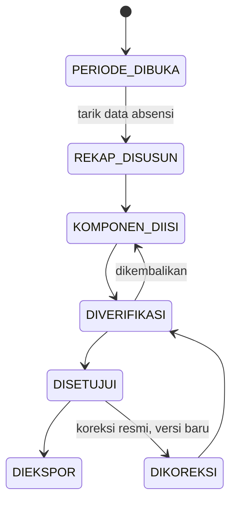

# Alur Payroll (Tahap Awal: Rekap)

## Ruang lingkup tahap awal
Periode, rekap absensi, komponen payroll, verifikasi, persetujuan rekap, ekspor.
**Tidak termasuk:** hitung gaji final, PPh 21, BPJS, slip gaji, pembayaran/transfer otomatis. Struktur untuk fase berikutnya hanya dirancang (`payroll_runs`, `payroll_items`, `payment_records`, `payroll_rule_versions`), belum dibuat.

Payroll dipisah: tenaga kerja outsourcing pada rekanan, dan staff internal.

## Isi rekap
Per karyawan per periode: hari/jam hadir, keterlambatan, lembur, izin, cuti, dan komponen (tunjangan, potongan, insentif) sebagai nilai masukan. Nominal memakai `NUMERIC`/Decimal.

## Kewenangan
Pembuat, pemeriksa, penyetuju, dan finalisator harus orang berbeda; sistem menegakkannya. Rekap yang disetujui tidak dapat diubah diam-diam.

## Ekspor
Format **xlsx, CSV, PDF**. Pekerjaan latar untuk data besar; file di bucket privat dengan URL bertanda tangan singkat; sel berawalan `=`, `+`, `-`, `@` dinetralkan (anti formula injection); setiap ekspor diaudit. Kolom final menunggu format dari pemilik.

## Aturan regulasi
Tarif dan ketentuan (PPh 21, BPJS, kompensasi PKWT, lembur) tidak boleh diasumsikan. Pada fase berikutnya disimpan sebagai data berversi dengan tanggal berlaku dan diverifikasi ahli.

> **Status implementasi (Fase 8):** diimplementasikan (ADR-0009). Penyederhanaan dari diagram awal: status rekap `DRAFT → DIVERIFIKASI → DISETUJUI → DIFINALISASI` (+ `DIGANTIKAN`); "tarik absensi" dan "isi komponen" terjadi dalam DRAFT; `DIEKSPOR` bukan status melainkan catatan ekspor (`payroll_exports`); `DIKOREKSI` = versi koreksi bernomor `KRP/<tahun>/<urut>` yang menempuh alur penuh. Rute: `/payroll/periods`, `/payroll/recaps/:id` (+ `pull`, `lines`, `components`, `verify`, `return`, `approve`, `finalize`, `correct`, `export.csv|xlsx|pdf`, `exports`). Pembuat, pemeriksa, penyetuju, finalisator harus orang berbeda (aplikasi + database). Tidak ada hitung gaji final, PPh 21, BPJS, slip, atau pembayaran. Kolom ekspor sementara (A-42).
