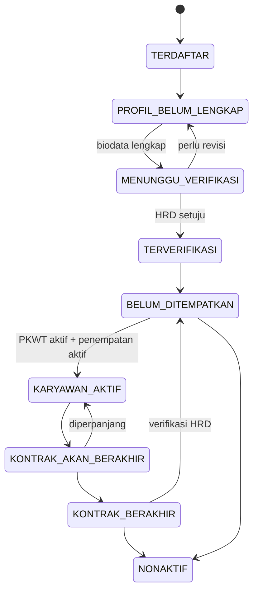
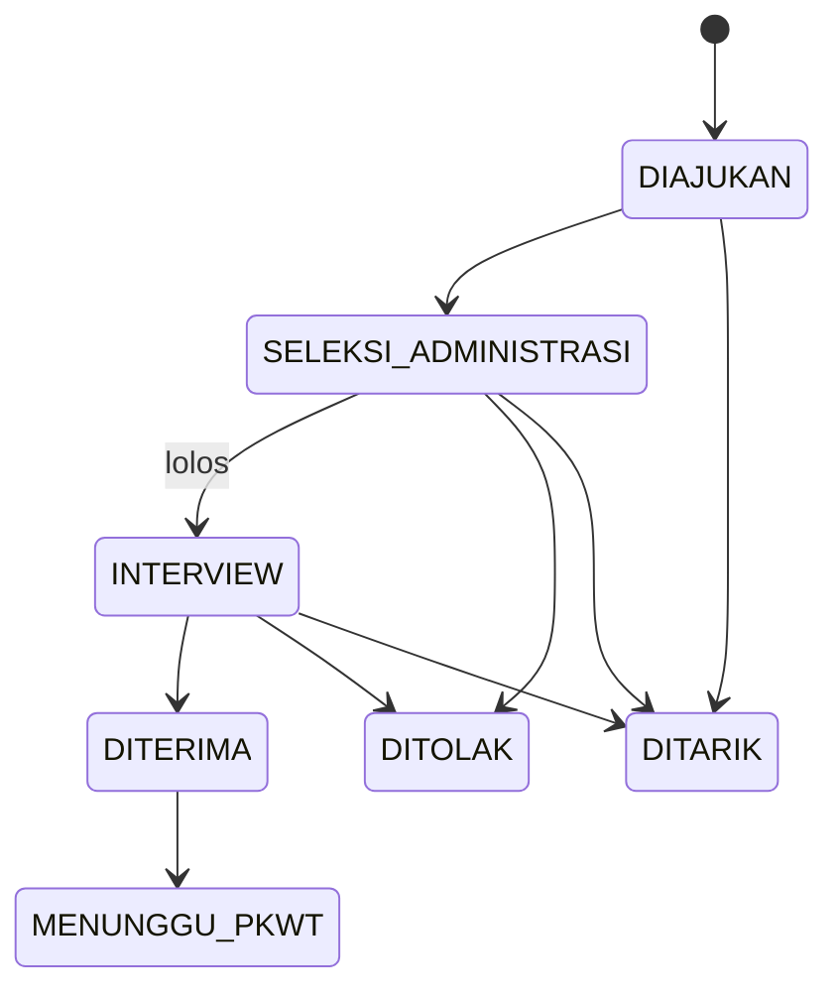
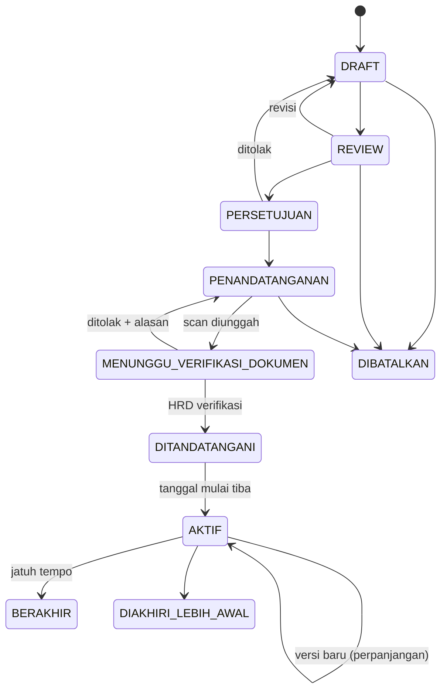
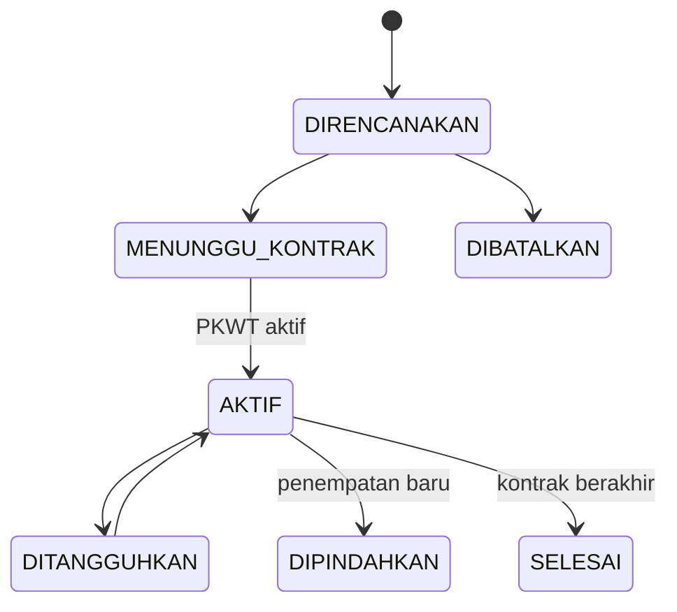

# Alur Rekrutmen, PKWT, dan Penempatan

Status akun, profil, lamaran, kontrak, dan penempatan dipisah. "Tahap member" hanya tampilan turunan. Setiap transisi dicatat di `status_histories` (waktu, petugas, alasan).

## Member

## Lowongan dan lamaran
- Member belum ditempatkan melihat dan melamar lowongan **semua perusahaan Group**. Tiap lowongan wajib punya perusahaan pengelola.
- Staff mengelola lowongan dan lamaran hanya pada perusahaan dalam scope-nya.
- Guard backend `CanApply`: tolak (403) bila status `KARYAWAN_AKTIF` atau `KONTRAK_AKAN_BERAKHIR`; UI menyembunyikan menu lowongan, tetapi backend yang menegakkan.
- Kembali ke pencari kerja setelah `KONTRAK_BERAKHIR` hanya lewat verifikasi HRD.

## PKWT
Tahap awal: generate PDF, cetak, tanda tangan basah, scan dan unggah, verifikasi HRD. Tombol "setuju" bukan tanda tangan sah. Template resmi menyusul dan **tidak ada klausul hukum karangan**; template berstatus `BELUM_DIVERIFIKASI` tidak dapat dipakai untuk kontrak aktif. Arsitektur menyediakan `SignatureProvider` untuk integrasi PSrE tersertifikasi pada fase berikutnya.

Setiap perubahan = versi baru di `contract_versions` (tidak menimpa). Masa kerja, perpanjangan, dan kompensasi mengikuti aturan berversi yang diverifikasi ahli hukum.

> **Status implementasi (Fase 5):** alur member dan lamaran di atas sudah diimplementasikan sampai lamaran `MENUNGGU_PKWT` dan member `BELUM_DITEMPATKAN`. PKWT, penempatan, dan status `KARYAWAN_AKTIF` dan seterusnya (otomatis) dikerjakan di Fase 6; `CanApply` sudah menegakkan blokir karyawan aktif di backend.

## Penempatan

Dua penempatan aktif yang tumpang tindih untuk satu karyawan ditolak oleh database.
